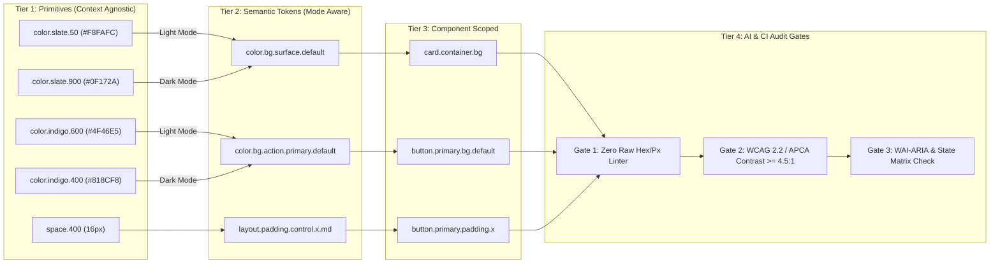

# Architecture Documentation: Flosurf Enterprise Design System

## 1. Executive Summary & Philosophy
Flosurf replaces third-party subscription aggregators (`designsystems.surf` Pro - $99/yr) with a self-hosted, enterprise-grade architecture:
- **W3C Design Token Community Group (DTCG) Taxonomy**: Strict 3-tier separation of concerns (Primitives &rarr; Semantic &rarr; Component).
- **Multi-Mode Theming Engine**: Native compile-time and runtime switching across `light`, `dark`, and `high-contrast` modes.
- **Style Dictionary v4 Pipeline**: Cross-platform distribution (CSS custom properties, Tailwind v4 theme, Tailwind v3 preset, iOS Swift & Asset Catalogs, Android XML).
- **Automated CI/CD Audit Gates**: Zero hardcoded hex/px linter with OKLab Delta-E auto-mapping, WCAG 2.2 / APCA contrast verification, and state matrix contract validation.
- **Local Agentic Skills & REA MCP Integration**: Native Antigravity IDE skills (`audit-system`, `spec-generator`) and reverse-engineering capabilities (`morluto/rea`).

---

## 2. 3-Tier W3C Token Taxonomy

| Tier | Layer | Purpose | Naming Pattern | Example Token | Mode Switching |
| :--- | :--- | :--- | :--- | :--- | :--- |
| **Tier 1** | **Primitive (Core)** | Context-agnostic brand palette, spacing scale, typographic curves. | `{category}.{scale}.{variant}` | `color.indigo.600` (`#4F46E5`), `space.400` (`16px`) | **Single mode** (Hidden from publishing) |
| **Tier 2** | **Semantic (Alias)** | Context-aware intent. Switches across modes dynamically. | `{category}.{intent}.{role}.{state}` | `color.bg.action.primary.default` | **Light / Dark / High-Contrast** |
| **Tier 3** | **Component (Scoped)** | Scoped to visual primitives (Button, Card, Input). | `{component}.{element}.{property}.{state}` | `button.primary.bg.hover` | Inherits from Tier 2 |

### Context Flow Diagram


---

## 3. Pre-Handoff 4-Stage Architectural Gates

### Gate 1: Zero Hardcoded Value Linter
- **Rule**: Zero raw hex colors (`#hex`), `rgb(...)`, or raw pixel dimensions in component styles.
- **Engine**: Scans source files and automatically computes the nearest Tier-2 Semantic token using OKLab $\Delta E$ perceptual color distance.
- **Run**: `npm run audit:hardcoded src`

### Gate 2: Multi-Mode Contrast Verification
- **Rule**: Every foreground/background pairing in `audit/contrast-pairs.json` must satisfy WCAG 2.2 AA ($\ge 4.5:1$ text, $\ge 3.0:1$ UI controls) in **Light**, **Dark**, and **High-Contrast** modes.
- **APCA Support**: Computes and logs APCA $L_c$ values for WCAG 3 forward-compatibility.
- **Run**: `npm run audit:contrast`

### Gate 3: State Matrix & WAI-ARIA Contract
- **Rule**: Interactive component tokens must specify the complete 6-state matrix:
  1. `default`
  2. `hover`
  3. `focus-visible` (must include focus ring tokens)
  4. `active`
  5. `disabled`
  6. `loading`
- **WAI-ARIA Pattern**: Interactive elements must implement appropriate roles (`role="button"`), `aria-busy`, and `aria-disabled`.
- **Run**: `npm run audit:states`

### Gate 4: Layout & Stress Test
- Tested at 300% text zoom and long-string localization (German/Finnish compound words) to guarantee zero layout truncation or overflow.

---

## 4. Reverse Engineering via REA (`morluto/rea`)
REA connects directly to Antigravity IDE via MCP to inspect third-party apps, Storybook bundles, or Electron binaries to reverse engineer tokens, theme machines, and focus ring systems.

### REA Agent Playbook
```text
@rea Inspect the target bundle at /Applications/TargetApp.app (or local web build directory).
Trace the theme initialization module, extract the full CSS custom property token map,
and document the state machine used for focus-ring accessibility and dark-mode switching.
Pipe the extracted findings into a local rule file.
```

---

## 5. Curated Open-Source Reference Hubs
- **W3C DTCG Format Specification**: https://tr.designtokens.org/format/
- **Adobe Spectrum Token Taxonomy**: https://spectrum.adobe.com/page/design-tokens/
- **GitHub Primer Primitives**: https://github.com/primer/primitives
- **MagentaA11y (T-Mobile)**: https://www.magentaa11y.com/
- **Radix Primitives**: https://www.radix-ui.com/primitives
- **React Aria (Adobe)**: https://react-spectrum.adobe.com/react-aria/
- **The Component Gallery**: https://component.gallery/
- **Design System Checklist**: https://www.designsystemchecklist.com/
