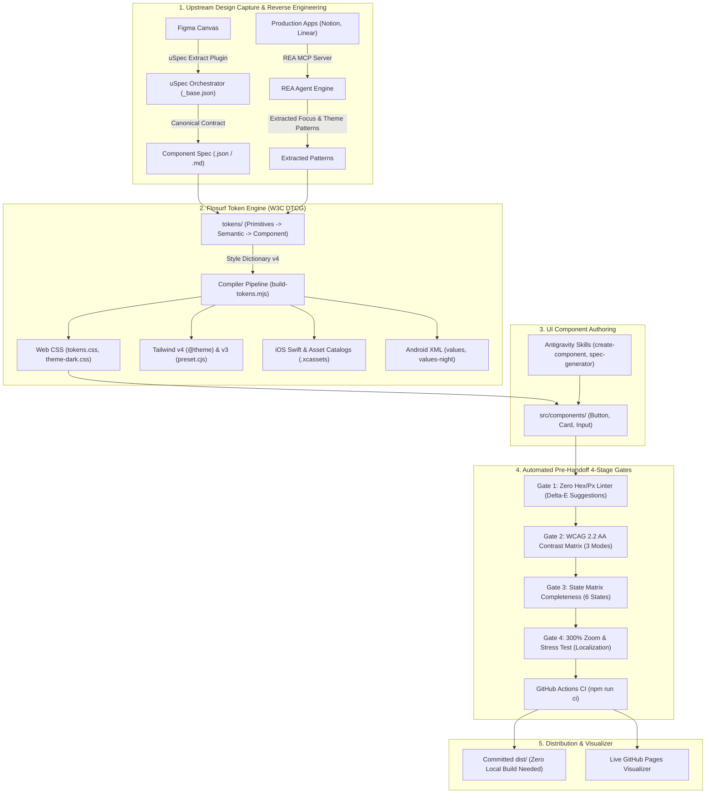

# Architecture Documentation: Flosurf Enterprise Design System

## 1. Executive Summary & Philosophy
Flosurf replaces third-party subscription aggregators (`designsystems.surf` Pro - $99/yr) with a self-hosted, enterprise-grade architecture:
- **W3C Design Token Community Group (DTCG) Taxonomy**: Strict 3-tier separation of concerns (Primitives &rarr; Semantic &rarr; Component).
- **Multi-Mode Theming Engine**: Native compile-time and runtime switching across `light`, `dark`, and `high-contrast` modes.
- **Style Dictionary v4 Pipeline**: Cross-platform distribution (CSS custom properties, Tailwind v4 theme, Tailwind v3 preset, iOS Swift & Asset Catalogs, Android XML).
- **Automated CI/CD 4-Stage Audit Gates**: Zero hardcoded hex/px linter, WCAG 2.2 / APCA contrast verification, state matrix contract validation, and 300% zoom / long-string layout stress testing.
- **Upstream & Downstream Agent Workflows**: Integration with `redongreen/uSpec` (upstream Figma contract extraction) and `morluto/rea` (downstream runtime reverse engineering).

---

## 2. End-to-End Tooling Map: How Everything Fits (Zero Duplicate Jobs)

A common point of confusion in modern design systems is knowing which tool owns which phase. Flosurf establishes strict non-overlapping boundaries:

| Tool | Stage | Input | Output | Distinct Responsibility |
| :--- | :--- | :--- | :--- | :--- |
| **`uSpec`** (`redongreen/uSpec`) | **Upstream Design Capture** | Figma designs via `uSpec Extract` | Canonical `.json` contract & `.md` spec | Translates visual Figma components into formal API, anatomy, color, and voice specifications. Runs forward from design to spec. |
| **`REA`** (`morluto/rea`) | **Competitive Reverse Engineering** | 3rd-party apps (Notion, Linear, Slack) | Extracted CSS property maps & focus state machines | Inspects compiled web, Electron, or native bundles when no Figma files exist. Runs backward from compiled apps to tokens. |
| **`Flosurf DTCG Core`** | **Single Source of Truth** | `tokens/` JSON files | W3C DTCG Token Graph | Authoritative hierarchy of brand primitives, multi-mode semantic aliases, and scoped component tokens. |
| **`Style Dictionary v4`** | **Cross-Platform Compiler** | `tokens/` | `dist/` (CSS, Tailwind, iOS, Android) | Compiles the token graph into target platform artifacts. Runs during CI or local builds. |
| **`Flosurf Component Library`** | **UI Implementation** | Token CSS variables | `src/components/` (Button, Card, Input) | Production UI primitives built with zero hardcoded values and strict WAI-ARIA compliance. |
| **`Flosurf 4-Stage CI Gates`** | **Automated Governance** | Source code & compiled tokens | Blocking CI Pass/Fail | Enforces the design system contract on every commit so bad code never merges. |
| **`Flosurf Visualizer`** | **Inspection & Sandbox** | Pre-compiled distribution | Localhost / GitHub Pages | Interactive UI for inspecting the token graph, testing theme switching, and live component sandboxing. |

---

## 3. 3-Tier W3C Token Taxonomy

| Tier | Layer | Purpose | Naming Pattern | Example Token | Mode Switching |
| :--- | :--- | :--- | :--- | :--- | :--- |
| **Tier 1** | **Primitive (Core)** | Context-agnostic brand palette, spacing scale, typographic curves. | `{category}.{scale}.{variant}` | `color.indigo.600` (`#4F46E5`), `space.400` (`16px`) | **Single mode** (Hidden from publishing) |
| **Tier 2** | **Semantic (Alias)** | Context-aware intent. Switches across modes dynamically. | `{category}.{intent}.{role}.{state}` | `color.bg.action.primary.default` | **Light / Dark / High-Contrast** |
| **Tier 3** | **Component (Scoped)** | Scoped to visual primitives (Button, Card, Input). | `{component}.{element}.{property}.{state}` | `button.primary.bg.hover`, `input.default.border.focus` | Inherits from Tier 2 |

---

## 4. Pre-Handoff 4-Stage Architectural Gates

### Gate 1: Zero Hardcoded Value Linter
- **Rule**: Zero raw hex colors (`#hex`), `rgb(...)`, or raw pixel dimensions in component styles.
- **Engine**: Scans source files and automatically computes the nearest Tier-2 Semantic token using OKLab $\Delta E$ perceptual color distance.
- **Run**: `npm run audit:hardcoded src`

### Gate 2: Multi-Mode Contrast Verification
- **Rule**: Every foreground/background pairing in `audit/contrast-pairs.json` must satisfy WCAG 2.2 AA ($\ge 4.5:1$ text, $\ge 3.0:1$ UI controls) in **Light**, **Dark**, and **High-Contrast** modes.
- **APCA Support**: Computes and logs APCA $L_c$ values for WCAG 3 forward-compatibility.
- **Run**: `npm run audit:contrast`

### Gate 3: State Matrix & WAI-ARIA Contract
- **Rule**: Interactive component tokens must specify the complete 6-state matrix:
  1. `default`
  2. `hover`
  3. `focus-visible` (must include focus ring tokens)
  4. `active`
  5. `disabled`
  6. `loading`
- **WAI-ARIA Pattern**: Interactive elements must implement appropriate roles (`role="button"`, `role="textbox"`), `aria-busy`, `aria-disabled`, and `aria-invalid`.
- **Run**: `npm run audit:states`

### Gate 4: Layout & Stress Test
- **Rule**: Root containers must use fluid auto-height or `minHeight` instead of fixed `height: ...px` to survive **300% text zoom**.
- **Localization Resilience**: Tested against agglutinative and long compound words across all 4 primary South African derivation language groups (encompassing 14+ official languages and regional dialects: Nguni [isiZulu/isiXhosa], Sotho-Tswana [Sesotho/Setswana], Afrikaans, and Tsonga/Venda with Unicode diacritics) to ensure zero clipping, fluid expansion, and safe wrapping.
- **Run**: `npm run audit:stress`

---

## 5. Curated Open-Source Reference Hubs
- **W3C DTCG Format Specification**: https://tr.designtokens.org/format/
- **Adobe Spectrum Token Taxonomy**: https://spectrum.adobe.com/page/design-tokens/
- **GitHub Primer Primitives**: https://github.com/primer/primitives
- **MagentaA11y (T-Mobile)**: https://www.magentaa11y.com/
- **Radix Primitives**: https://www.radix-ui.com/primitives
- **React Aria (Adobe)**: https://react-spectrum.adobe.com/react-aria/
- **The Component Gallery**: https://component.gallery/
- **Design System Checklist**: https://www.designsystemchecklist.com/
