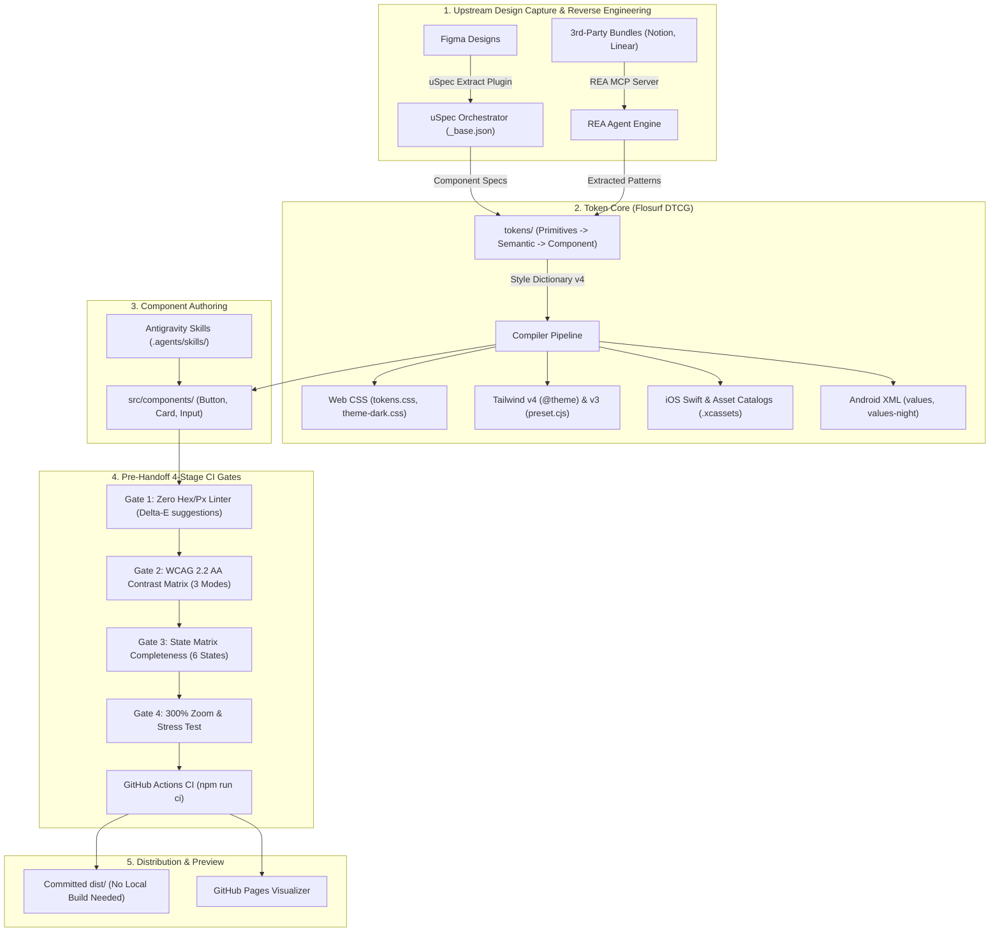

# Flosurf Design System Best Practices & Authoring Guide

> Enterprise-grade handbook replacing paid aggregator subscriptions (`designsystems.surf` Pro). Covers core principles, the component lifecycle runbook, token taxonomy, accessibility standards, and the end-to-end tooling architecture.

---

## 1. The 10 Invariant Design System Principles

1. **Zero Hardcoded CSS Rule**: Never use raw hex (`#0F172A`), raw RGB/RGBA, or raw pixel measurements (`16px`) in component source code. All properties must bind to CSS variables emitted by the token pipeline (`var(--...)`).
2. **Strict 3-Tier W3C Token Separation**:
   - **Tier 1 (Primitives)**: Context-agnostic raw brand values. Never consume directly in UI components.
   - **Tier 2 (Semantic)**: Mode-aware semantic aliases (`--color-bg-surface-*`, `--layout-padding-*`).
   - **Tier 3 (Component)**: Scoped overrides strictly tied to an individual component primitive (`--button-primary-bg-*`).
3. **Multi-Mode Parity**: Every semantic token must resolve cleanly in `light`, `dark`, and `high-contrast` modes. Dark mode is not an inverted afterthought; it has dedicated luminance-tuned foregrounds and backgrounds.
4. **WCAG 2.2 AA Contrast as a Blocking Contract**: All text pairings must meet at least **4.5:1** contrast; all interactive UI boundaries and focus indicators must meet at least **3.0:1** across all 3 modes.
5. **The 6-Stage State Matrix**: Every interactive component must define tokens and visual treatments for:
   `default` &bull; `hover` &bull; `focus-visible` &bull; `active` &bull; `disabled` &bull; `loading`.
6. **WAI-ARIA & Keyboard First**:
   - Explicit `role` definition where native HTML tags are insufficient.
   - Screen-reader state reflection via `aria-busy`, `aria-disabled`, `aria-invalid`, and `aria-describedby`.
   - Complete keyboard operability (`Enter`, `Space`, `Tab`, `Escape`, Arrow navigation).
7. **Fluid Zoom & Localization Resilience**: Components must expand gracefully at 300% text zoom and accommodate long compound words (e.g. German, Finnish) without clipping. Always use `minHeight` instead of fixed `height`.
8. **Polymorphic, Unambiguous Props APIs**: Use discrete enum variants (`variant="primary" | "secondary" | "danger"`) rather than boolean prop flags (`<Button primary danger />`). Extend native HTML attributes.
9. **Machine-Readable Contracts Over Written Docs**: Component specifications must exist as machine-executable schema contracts (`tokens/component/*.json`) rather than ambiguous human prose.
10. **CI-First Handoff**: Design tokens and component libraries must be verified automatically by CI audit gates. Downstream consumers pull pre-compiled distributions (`dist/`) without requiring local build steps.

---

## 2. End-to-End Tooling Map: Where Every Tool Fits

To prevent duplicate jobs or overlapping workflows, each tool in the Flosurf ecosystem has a strictly defined lifecycle boundary:

| Tool / Subsystem | Stage | Input | Output | Primary Role |
| :--- | :--- | :--- | :--- | :--- |
| **`uSpec`** (`redongreen/uSpec`) | **Upstream Design Extraction** | Figma Component / `uSpec Extract` Plugin | `_base.json` &rarr; `component.json` + `component.md` | Extracts canonical component API, anatomy, color bindings, and voice annotations directly from Figma. |
| **`REA`** (`morluto/rea`) | **Competitive / Runtime Reverse Engineering** | Third-party compiled bundle, ASAR, or binary (e.g. Notion, Linear) | Extracted CSS property maps & focus state machines | Reverse engineers how leading production apps implement theme switching, focus rings, and layout boundaries. |
| **`Flosurf DTCG Tokens`** | **Design Token Source of Truth** | JSON files (`tokens/primitives`, `tokens/semantic`, `tokens/component`) | W3C DTCG Token Tree | Master repository of brand primitives, multi-mode aliases, and scoped component overrides. |
| **`Style Dictionary v4`** | **Compilation Engine** | DTCG JSON Tokens | `dist/css/`, `dist/tailwind/`, `dist/ios/`, `dist/android/` | Transforms tokens into production-ready web CSS, Tailwind v4/v3, Swift/Asset Catalogs, and Android XML. |
| **`Flosurf CI Audit Gates`** | **Automated Quality Gate** | `src/components/*.tsx`, `dist/json/*.json` | Pass/Fail Gate Reports | **Gate 1**: Zero hex/px linter.<br>**Gate 2**: Multi-mode WCAG contrast.<br>**Gate 3**: State matrix completeness.<br>**Gate 4**: 300% zoom stress test. |
| **`Flosurf Visualizer`** | **Interactive Inspection** | Pre-built token graph + components | Localhost / GitHub Pages UI | Visualizes the token graph, live theme switcher, sandbox components, and linter playground. |
| **`Antigravity Agent Skills`** | **Agent Pair-Programming** | Code, Figma links, or DOM snippets | Generated code specs and audits | `create-component`, `spec-generator`, `audit-system`. |



---

## 3. Step-by-Step Component Authoring Runbook

When adding a new component to Flosurf:

### Phase 1: Anatomy & Token Definition
1. Map the component's root container and slots (e.g. Prefix, Suffix, Label, Helper).
2. Create `tokens/component/{component}.json`.
3. If interactive, define all 6 states (`default`, `hover`, `focus-visible`, `active`, `disabled`, `loading`) referencing Tier 2 semantic tokens.
4. Run `npm run build` to compile the tokens across all target platforms.

### Phase 2: Component Implementation
1. Create `src/components/{Component}.tsx`.
2. Extend native HTML props (`React.ComponentPropsWithoutRef<'button'>`, `'input'`, etc.).
3. Apply styling exclusively via `var(--...)` custom properties matching the compiled Tier 3 tokens.
4. Provide appropriate WAI-ARIA states (`aria-busy`, `aria-disabled`, `aria-invalid`, `aria-describedby`).
5. Guarantee responsive flex/grid bounds using `minHeight` rather than fixed `height`.

### Phase 3: Validation & Gate Verification
Execute the local test suite:
```bash
npm run audit:hardcoded src/{Component}.tsx  # Gate 1
npm run audit:contrast                       # Gate 2
npm run audit:states                         # Gate 3
npm run audit:stress                         # Gate 4
```

---

## 4. Typography, Spacing, and Elevation Systems

### Spacing Scale (4px Base Grid)
| Token | Pixel Value | Rem Equivalent | Primary Usage |
| :--- | :--- | :--- | :--- |
| `--space-25` | 1px | 0.0625rem | Hairline borders, subtle dividers |
| `--space-50` | 2px | 0.125rem | Focus ring offsets, micro gaps |
| `--space-100` | 4px | 0.25rem | Compact icon/label gaps, tight padding |
| `--space-200` | 8px | 0.5rem | Control vertical padding (sm), standard gaps |
| `--space-300` | 12px | 0.75rem | Control horizontal padding (sm), card sub-gaps |
| `--space-400` | 16px | 1.0rem | Standard control padding (md), container gaps |
| `--space-600` | 24px | 1.5rem | Large control padding (lg), section insets |
| `--space-800` | 32px | 2.0rem | Dialog/Modal padding, page gutters |
| `--space-1000` | 40px | 2.5rem | Standard touch target min-height |
| `--space-1200` | 48px | 3.0rem | Large touch target min-height |

### Elevation & Z-Index Scale
| Token | Value | Intended Surface |
| :--- | :--- | :--- |
| `--elevation-z-base` | 0 | Default canvas surface |
| `--elevation-z-dropdown` | 100 | Menus, popovers, autocomplete suggestions |
| `--elevation-z-overlay` | 200 | Sticky headers, backdrop scrims |
| `--elevation-z-modal` | 300 | Dialogs, confirmation modals |
| `--elevation-z-toast` | 400 | Snackbars, urgent notifications |
